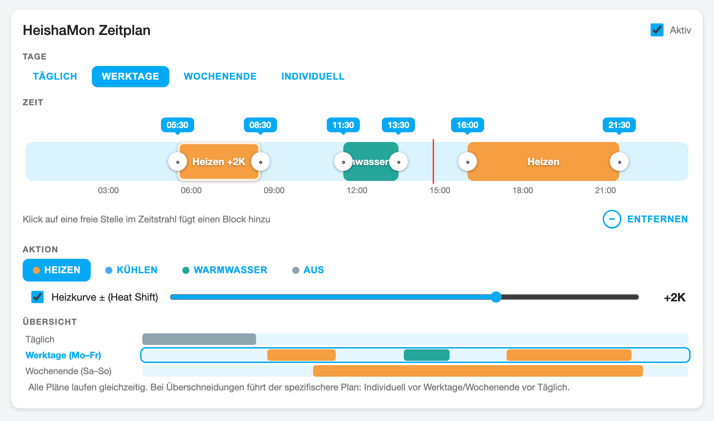
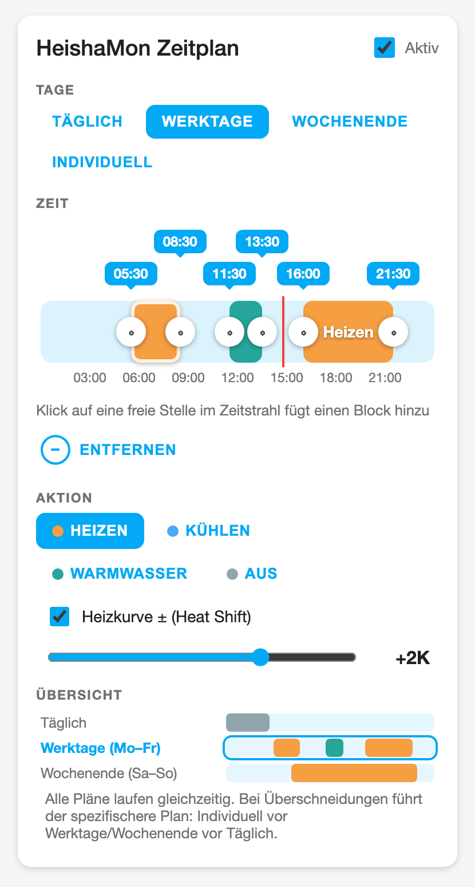

<picture>
  <source media="(prefers-color-scheme: dark)" srcset="custom_components/heishamon_scheduler/brand/dark_icon.png">
  
</picture>

# HeishaMon Scheduler

Zeitblock-Steuerung für Panasonic-Aquarea-Wärmepumpen über
[HeishaMon](https://github.com/heishamon/HeishaMon) — als Home-Assistant-Integration
mit visueller Timeline-Karte im Stil der bekannten Scheduler-Card.

## Screenshots

| Desktop | Mobil |
|---|---|
|  |  |

## Konzept

Statt starrer Wochenpläne definierst du **Zeitblöcke**: „Werktags 07–12 Uhr
Heizen“, „Täglich 12–14 Uhr Warmwasser mit 48 °C“.

- **Innerhalb eines Blocks** sendet die Integration die gewählte Aktion per
  MQTT an HeishaMon und steuert damit die Wärmepumpe.
- **Außerhalb der Blöcke passiert nichts** — die Pumpe läuft mit ihren
  eigenen Einstellungen (Heizkurve, HeishaMon-Konfiguration).
- **Beim Blockende wird der vorherige Zustand wiederhergestellt:** Beim
  Blockstart merkt sich die Integration den Ist-Zustand der Pumpe (aus den
  HeishaMon-Feedback-Topics) und sendet ihn danach zurück.

## Modi

Jeder Block hat einen von vier Modi, optional mit einer Unteroption
(wird nur gesendet, wenn aktiviert — sonst bleibt die Pumpen-Einstellung
unverändert):

| Modus | MQTT-Kommando | Unteroption | Nach Blockende |
|---|---|---|---|
| Heizen | `SetOperationMode` = Heat | Heizkurve ± (`SetZ1HeatRequestTemperature`, −5…+5 K) | vorheriger Modus + Shift |
| Kühlen | `SetOperationMode` = Cool | Kühl-Temperatur (`SetZ1CoolRequestTemperature`) | vorheriger Modus + Temperatur |
| Warmwasser | `SetOperationMode` = DHW | Soll-Temperatur (`SetDHWTemp`, 40–75 °C) | vorheriger Modus + Solltemperatur |
| Aus | `SetHeatpump` = 0 | — | Wärmepumpe an |

Ist die Wärmepumpe beim Blockstart **ausgeschaltet**, schalten
Heizen/Kühlen/Warmwasser sie automatisch ein (`SetHeatpump` = 1) — und am
Blockende wieder aus, da der vorherige Zustand wiederhergestellt wird.

Kommandos werden gedrosselt (min. 30 s Abstand). Über das LWT-Topic erkennt
die Integration, ob HeishaMon online ist; bei Reconnect wird sofort neu
ausgewertet.

## Karte

Die mitgelieferte Lovelace-Karte bietet:

- Tag-Gruppen: **Täglich / Werktage / Wochenende / Individuell**
- Timeline mit **ziehbaren Blockgrenzen** (10-Minuten-Raster, Touch-fähig)
- **Klick auf eine freie Stelle im Zeitstrahl legt einen neuen Block an**
- Modus und Unteroption (Checkbox + Slider) pro Block
- **Übersicht** aller Tag-Gruppen mit Mini-Zeitzeilen, klickbar zum Wechseln
- Master-Schalter zum Pausieren des gesamten Zeitplans
- Für Mobilgeräte optimiert (versetzte Zeitblasen, Touch-Bedienung)

Die Karte wird von der Integration automatisch geladen — kein Kopieren nach
`/config/www/`, kein Ressourcen-Eintrag nötig.

## Entitäten

- `sensor` **Active Actions** — welche Blöcke/Aktionen gerade aktiv sind
- `switch` **Schedule Enabled** — Zeitplan pausieren/aktivieren
- `binary_sensor` **HeishaMon Online** — Verbindungsstatus per LWT

## Voraussetzungen

- HeishaMon (Firmware 4.x empfohlen) mit MQTT verbunden
- Home Assistant ≥ 2024.12 mit eingerichteter MQTT-Integration

## Installation

1. Repository als [HACS](https://hacs.xyz)-Custom-Repository (Typ: Integration)
   hinzufügen und **HeishaMon Scheduler** herunterladen — oder den Ordner
   `custom_components/heishamon_scheduler` nach `config/custom_components/`
   kopieren.
2. Home Assistant neu starten und die Integration **HeishaMon Scheduler** über
   *Einstellungen → Geräte & Dienste* hinzufügen.
3. Dem Dashboard eine Karte vom Typ **HeishaMon Scheduler** hinzufügen
   (*Dashboard bearbeiten → Karte hinzufügen → nach „HeishaMon“ suchen*).

## Konfiguration

Beim Einrichten wird das MQTT-Basis-Topic gewählt (Standard:
`panasonic_heat_pump`). Über **Optionen** der Integration lassen sich ändern:

| Option | Bedeutung |
|---|---|
| MQTT Basis-Topic | Muss dem HeishaMon-Basis-Topic entsprechen |
| Z1 Heat Request Min/Max | `-5…5` für Shift-Betrieb, z. B. `20…55` für Direkt-Temperatur |

## Hinweise

- Alle Tag-Gruppen laufen gleichzeitig; die Tabs in der Karte sind nur ein
  Bearbeitungs-Filter. Überlappen sich Blöcke aus verschiedenen Gruppen,
  führt der **spezifischere** Plan (weniger Tage): Individuell vor
  Werktage/Wochenende vor Täglich. Die Übersicht unten in der Karte zeigt
  alle Gruppen mit ihren Zeitzeilen.
- Beim Update von Version 1.x startet der Zeitplan leer (neues Datenmodell);
  die alten Wochenplan-Daten bleiben im Storage erhalten, werden aber nicht
  mehr verwendet. Verwaiste Entitäten der 1.x-Kanäle können in HA gelöscht
  werden.
